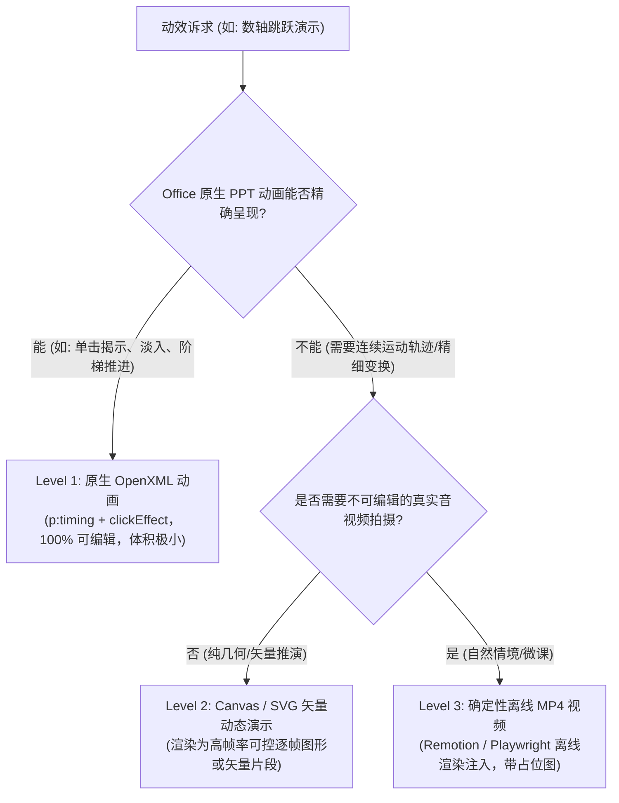

# 分层解耦的智能课件生成引擎架构规范 (Modular Courseware Architecture)

> 本文档规范了小学人教版课件生成系统的分层架构演进路径。
> 核心原则：**教学内容（怎么教）、页面表现（怎么画）、动画时序（怎么播）三层彻底解耦**。
> 坚决避免让大模型一步决定 PPT 坐标、字号与动画，坚决避免为每个年级和学科硬编码死板模版。

---

## 目录
1. [架构愿景与现有瓶颈剖析](#一架构愿景与现有瓶颈剖析)
2. [八层架构体系与职责边界](#二八层架构体系与职责边界)
3. [核心数据契约：双 AST 设计](#三核心数据契约双-ast-设计)
   - 3.1 教学内容 AST (LessonPlan AST)
   - 3.2 课件表现 AST (Presentation AST)
4. [多维策略解析矩阵 (Strategy Matrix)](#四多维策略解析矩阵-strategy-matrix)
   - 4.1 年级认知策略 (Grade Cognitive Strategy)
   - 4.2 学科表达策略 (Subject Expression Strategy)
   - 4.3 课型流程策略 (Lesson Type Strategy)
   - 4.4 优先级仲裁机制 (Priority Arbitration)
5. [动画与媒体策略引擎 (Motion Strategy Engine)](#五动画与媒体策略引擎-motion-strategy-engine)
   - 5.1 五大动效语义 (Motion Semantics)
   - 5.2 三级渐进降级通道 (3-Level Graceful Degradation)
   - 5.3 严格代码执行护栏 (Execution Guardrails)
6. [双阶段确定性校验门禁 (Dual Gateways)](#六双阶段确定性校验门禁-dual-gateways)
   - 6.1 阶段一：教学内容验证 (LessonValidator)
   - 6.2 阶段二：课件表现与几何体检 (PresentationValidator & LayoutAudit)
7. [结合本项目工程实际的技术选型与资产映射](#七结合本项目工程实际的技术选型与资产映射)
   - 7.1 为什么坚持纯 Node.js (ESM) 技术栈
   - 7.2 现有代码模块的承接与重组映射
8. [四阶段渐进式落地路线图 (Roadmap)](#八四阶段渐进式落地路线图-roadmap)

---

## 一、架构愿景与现有瓶颈剖析

### 1.1 现状与瓶颈 (As-Is)
在前期原型阶段，系统采用“大模型一次性生成包含具体幻灯片数组的 `courseware.json`”模式：
- **内容与表现高度耦合**：大模型在同一个 JSON 结构中同时思考“算理怎么推导”与“这页放哪种卡片、是否加图元、字号大小”；
- **难以多模态复用**：同一个课件 JSON 无法直接降维输出“学生预习导学单”、“课堂任务卡”或“微课视频脚本”；
- **动画推导依赖后验启发式**：动效标签依赖渲染后期的正则和关键词推断（如匹配“参考答案”自动隐藏并淡入），缺乏表现层显式的时序定义（Timeline）；
- **策略隐式分散**：学科教学规范以自然语言形式散落在 Markdown prompt 中，缺少结构化的策略解析器。

### 1.2 演进目标 (To-Be)
遵循**“模型负责理解与规划，规则负责约束与决策，程序负责几何与渲染”**的原则：
1. **统一教学内容引擎**：先生成与具体介质（PPT/Word/视频）无关的 `LessonPlan AST`；
2. **多维策略正交组合**：通过 `年级 × 学科 × 课型` 策略继承与覆盖矩阵，生成 `Presentation AST`；
3. **内容驱动动效**：根据教学内容语义（概念推导、错因辨析、随堂诊断）匹配动画类型，并具备 L1~L3 降级能力；
4. **两道独立门禁**：内容合规性验证与几何排版体检彻底分离。

---

## 二、八层架构体系与职责边界

```
[第 1 层] 教师需求输入 (自然语言课题、年级、学科、课型偏好)
    ↓
[第 2 层] 教材事实提取 (SSOT 只读知识库：教材例题、重难点、易错点、数域边界)
    ↓
[第 3 层] 教学规划引擎 (LessonPlanner → 生成 LessonPlan AST)
    ↓ 【门禁 1: LessonValidator 教学法与合规性审查】
[第 4 层] 策略解析矩阵 (Strategy Resolver：年级认知 × 学科表达 × 课型流程)
    ↓
[第 5 层] 表现编排引擎 (PresentationPlanner → 生成 Presentation AST，含 Timeline)
    ↓ 【门禁 2: PresentationValidator 结构与时间线合法性审查】
[第 6 层] 确定性渲染引擎 (PptxGenJS + MotionEngine + DynamicMedia 子引擎)
    ↓ 【门禁 3: LayoutAudit 物理几何碰撞与溢出体检】
[第 7 层] 交付三件套 (.pptx + .audit.json + 讲稿备注与教学回执)
[第 8 层] 资产沉淀与反馈闭环 (课堂评价、错误用例扩充、回归测试金样库)
```

---

## 三、核心数据契约：双 AST 设计

### 3.1 教学内容 AST (LessonPlan AST)
**职责**：纯粹表达教学逻辑与认知过程，**严禁出现任何像素、坐标、字号、颜色与 PPT 动画标签**。

```json
{
  "$schema": "https://json-schema.org/draft/2020-12/schema",
  "lesson_id": "math-g3-t1-u04-l01",
  "meta": {
    "subject": "math",
    "grade": 3,
    "term": "term-1",
    "unit": 4,
    "topic": "整十、整百数乘一位数的口算",
    "lesson_type": "concept_learning",
    "duration_minutes": 40
  },
  "objectives": [
    {
      "id": "OBJ_01",
      "type": "cognitive",
      "statement": "理解整十、整百数乘一位数的算理，掌握计数单位累加的算法",
      "assessment": "能结合数轴模型解释 20×3=60 的思考过程"
    }
  ],
  "pedagogical_sequence": [
    {
      "phase_id": "phase_warmup",
      "phase_name": "情境导入",
      "target_objective": "OBJ_01",
      "content_block": {
        "block_type": "contextual_problem",
        "scenario": "游乐园碰碰车每人每次 20 元",
        "question": "3 人玩碰碰车需要多少钱？",
        "core_expression": "20 × 3"
      },
      "student_action": "列出乘法算式，结合已有生活经验猜想计算方法",
      "teacher_guidance": "引导学生从连加算式 20+20+20 引申到乘法含义"
    },
    {
      "phase_id": "phase_exploration",
      "phase_name": "算理探究",
      "target_objective": "OBJ_01",
      "content_block": {
        "block_type": "mathematical_reasoning",
        "model_type": "number_line",
        "model_payload": {
          "start": 0,
          "end": 60,
          "step": 20,
          "jumps": 3,
          "labels": ["0", "20", "40", "60"]
        },
        "reasoning_steps": [
          { "step": 1, "description": "1个20是20", "expression": "20 × 1 = 20" },
          { "step": 2, "description": "2个20是40", "expression": "20 × 2 = 40" },
          { "step": 3, "description": "3个20是60", "expression": "20 × 3 = 60" }
        ],
        "core_rule": "想：2个十 × 3 = 6个十 = 60"
      },
      "student_action": "观察数轴跳跃过程，用计数单位表达算理",
      "teacher_guidance": "强化计数单位转化为一位数乘法的转化思想"
    }
  ]
}
```

### 3.2 课件表现 AST (Presentation AST)
**职责**：将教学内容转化为具体的幻灯片结构，包含版面插槽、主题引用、学科图元属性以及显式动画时间线（Timeline）。

```json
{
  "$schema": "https://json-schema.org/draft/2020-12/schema",
  "deck_meta": {
    "source_lesson_id": "math-g3-t1-u04-l01",
    "theme_id": "clean_math_ocean",
    "grade_tier": "middle",
    "aspect_ratio": "16:9"
  },
  "slides": [
    {
      "slide_id": "slide_04",
      "phase_ref": "phase_exploration",
      "layout": "model_and_reasoning_split",
      "elements": [
        {
          "element_id": "title_bar",
          "type": "text_block",
          "role": "page_title",
          "text": "算理探究 · 数轴跳跃推演"
        },
        {
          "element_id": "nl_canvas",
          "type": "figure_number_line",
          "properties": {
            "start": 0,
            "end": 60,
            "step": 20,
            "unit": "元",
            "jump_arcs": 3
          }
        },
        {
          "element_id": "reasoning_cards",
          "type": "card_list",
          "items": [
            "1 个 20 是 20 (20×1=20)",
            "2 个 20 是 40 (20×2=40)",
            "3 个 20 是 60 (20×3=60)"
          ]
        },
        {
          "element_id": "rule_banner",
          "type": "highlight_banner",
          "role": "conclusion",
          "text": "★ 核心规律：2 个十 × 3 = 6 个十 = 60"
        }
      ],
      "timeline": [
        { "step": 0, "visible_elements": ["title_bar", "nl_canvas"] },
        { "step": 1, "action": "reveal", "target": "reasoning_cards", "sub_index": 0 },
        { "step": 2, "action": "reveal", "target": "reasoning_cards", "sub_index": 1 },
        { "step": 3, "action": "reveal", "target": "reasoning_cards", "sub_index": 2 },
        { "step": 4, "action": "reveal", "target": "rule_banner" }
      ],
      "speaker_notes": "引导学生观察数轴从0跳到20，再到40、60的过程，体会乘法本质是相同加数的累加。"
    }
  ]
}
```

---

## 四、多维策略解析矩阵 (Strategy Matrix)

避免为 6 个年级 × 3 个学科硬编码 18 套模板，采用**正交策略切面组合**。

### 4.1 年级认知策略 (Grade Cognitive Strategy)
| 学段维度 | 1-2 年级 (低段·启蒙具象) | 3-4 年级 (中段·图文进阶) | 5-6 年级 (高段·理性思辨) |
| :--- | :--- | :--- | :--- |
| **认知支架** | 高度具象：实物图、计数棒、田字格 | 结构模型：数轴、点子图、线段图 | 抽象符号：概念图、对比表格、代数表达式 |
| **视觉密度** | 单页核心信息 ≤ 3 块，大字号 (正文 24pt) | 单页核心信息 ≤ 4 块，中字号 (正文 20pt) | 容纳高密度信息，紧凑字号 (正文 18pt) |
| **动效节奏** | 单击步数 ≤ 3 步，直观显现 | 单击步数 3~5 步，过程推演 | 单击步数 2~4 步，侧重逻辑推论与对比 |

### 4.2 学科表达策略 (Subject Expression Strategy)
- **数学 (Math)**：
  - 核心内容块：`problem`、`model`、`reasoning`、`misconception`、`practice`
  - 图元模型偏好：`number_line` (数轴)、`fraction_bar` (分数条)、`place_value_table` (数位表)
  - 铁律约束：计算步骤守恒、算式排版左右对齐、严禁在数理推演区添加无教学意义的漂移动画。
- **语文 (Chinese)**：
  - 核心内容块：`text_excerpt`、`character_writing`、`vocabulary`、`reading_prompt`、`discussion`
  - 图元模型偏好：`tianzige` (田字格)、`pinyin_line` (拼音四线三格)、`structure_tree` (思维导图)
  - 铁律约束：原文严禁篡改缩写、生字必须标明部首与笔顺、字词解释必须附带语境。
- **英语 (English)**：
  - 核心内容块：`phonics`、`word_card`、`dialogue`、`pattern_drill`、`role_play`
  - 图元模型偏好：`dialogue_bubble` (对话泡泡)、`pronunciation_card` (音标发音卡)
  - 铁律约束：保持目标语言原汁原味、句型操练高亮核心变量替换词。

### 4.3 课型流程策略 (Lesson Type Strategy)

课型不是标签,而是结构化骨架,唯一事实源是 `lib_js/strategies/lesson_skeleton.js` 的 `LESSON_SKELETONS`
(策略表 `LESSON_TYPE_POLICIES.defaultPhases` 由它派生,禁止两处各写一份):

| 课型 | 骨架环节 | 收尾页 |
| :--- | :--- | :--- |
| `concept_learning` 新授课 | 情境导入 → 核心探究 → (例题示范) → (易错辨析) → 当堂练习 → 课堂小结 | — |
| `practice_consolidation` 练习课 | 复习唤醒 → 基础练习 → 变式练习 → (错因诊断) → 课堂小结 | 分层作业 |
| `unit_review` 复习课 | 知识网络 → 专题精练 → (错因诊断) → 课堂小结 | 板书结构 + 分层作业 |
| `experiment_inquiry` 实验课 | 问题情境 → 实验操作 → (结论探究) → 应用迁移 → 课堂小结 | 分层作业 |
| `reading_comprehension` 阅读课 | 情境导入 → (字词梳理) → 文本品读 → (研读思辨) → 当堂练习 → 课堂小结 | — |

括号内为可选环节。三条落地规则:

1. **角色归一 (`resolvePhaseRole`)**:`phase_id` 关键字优先(同一 `practice_challenge` 可区分基础/变式练习),
   `content_block.type` 兜底;语文"文本品读"作为"核心探究"的等价角色,不误判缺探究。
2. **缺口补齐**:必备环节缺失时,PagePlanner 按骨架锚点插入 `phase_placeholder` 占位页(虚线框 + 补什么/怎么补),
   并在构建日志告警;缺口多于已覆盖槽位时判为片段式课件,只诊断不补页。
3. **不重排**:教学顺序是教师专业判断,骨架只做顺序偏离诊断,绝不擅自重排。

### 4.4 优先级仲裁机制 (Priority Arbitration)
```
[最高优先级] Level 1: 教材事实源与学科教学禁区 (SSOT，一票否决，不可覆盖)
     ↓
[次高优先级] Level 2: 年级认知心理约束 (字号安全下限、内容块最大容积)
     ↓
[标准优先级] Level 3: 学科专属表达规范 (例题必配答语、语文必配拼音田字格)
     ↓
[应用优先级] Level 4: 课型流程骨架 (环节顺序与活动配置)
     ↓
[可选优先级] Level 5: 教师视觉偏好 (配色主题、强调高亮色，只在不破坏前置约束时生效)
```

---

## 五、动画与媒体策略引擎 (Motion Strategy Engine)

### 5.1 五大动效语义 (Motion Semantics)
系统严禁随心所欲设置动效，所有动画必须被归类为以下五种教学语义之一：
1. **`Reveal` (逐步揭示)**：
   - 教学意图：防止答案过早暴露，引导独立思考；
   - 典型场景：参考答案逐题弹出、例题答语弹出、文本关键词高亮。
2. **`Sequence` (流程时序)**：
   - 教学意图：呈现逻辑演绎的先后因果；
   - 典型场景：算式每一步推导、实验操作 1→2→3、汉字笔顺一笔一画。
3. **`Compare` (对比辨析)**：
   - 教学意图：通过视觉对冲强化正误认知；
   - 典型场景：易错警示页中“错解”与“正解”分栏呼应、多音字读音对比。
4. **`Transform` (状态形变)**：
   - 教学意图：动态呈现数量或空间位置演进；
   - 典型场景：数轴弧线跳跃、图形切割拼接、数位进位移位。
5. **`Media` (受控音视频媒体)**：
   - 教学意图：呈现高复杂度现实世界情境；
   - 典型场景：课文配乐朗读音频、科学实验实录微视频。

### 5.2 三级渐进降级通道 (3-Level Graceful Degradation)


### 5.3 严格代码执行护栏 (Execution Guardrails)
- **严禁**大模型直接编写 Python / JavaScript / Manim 等任意不受控执行脚本；
- 模型只能输出**参数化动画声明**（如 `{"action": "jump", "target": "number_line", "from": 0, "to": 20}`）；
- 由预编译好的确定性子引擎（如 `NumberLineAnimator`、`TianzigeStrokeAnimator`）负责具体计算与渲染。

---

## 六、双阶段确定性校验门禁 (Dual Gateways)

### 6.1 阶段一：教学内容验证 (`LessonValidator`)
对 `LessonPlan AST` 进行拦截校验（退出码非 0 则中断）：
- **知识点对齐度**：引用的 `point_id` 是否真实存在于教材知识库中；
- **数域与边界禁区**：数学题数值是否突破单元上限（`numeric_upper_bound`），是否存在 `scope_excluded` 禁讲内容；
- **教学环节闭环**：导入、探究、应用、评价各环节是否齐全，评价活动是否能有效检验预设目标；
- **例题真实性**：教材例题是否忠实于教材原文，杜绝大模型随意胡编改写。

### 6.2 阶段二：课件表现与几何体检 (`PresentationValidator` & `LayoutAudit`)
对 `Presentation AST` 及渲染后的 `.pptx` 进行物理级审计：
- **Schema 结构合法性**：元素 ID 唯一性、时间线引用的 `target` 必须存在；
- **几何碰撞与文字溢出 (`LayoutAudit`)**：
  - 任何文本框计算所需高度 `h_req` 超出容器可用高度 `h_actual` 即判定为 `TEXT_OVERFLOW` (一票否决)；
  - 元素外边距与画布安全边界重叠检测；
- **动效规范检查**：
  - OOXML 中 `<p:transition>` 必须排在 `<p:timing>` 之前；
  - 时间线 step 必须从 1 开始单调递增，无悬空对象。

---

## 七、结合本项目工程实际的技术选型与资产映射

### 7.1 为什么坚持纯 Node.js (ESM) 技术栈
外部建议中出现了部分 `.py` 脚本命名，但结合本仓库实际情况，**必须坚定不移地采用纯 Node.js (ESM) 体系**：
1. **已有资产厚度**：本项目核心渲染引擎基于 `PptxGenJS`，结合 `xml2js` 底层解包，动效注入器 `deck_transition.js`、几何审计 `layout_audit.js`、图元引擎 `figures.js` 均为成熟的 Node.js 模块；
2. **轻量与单运行时部署**：保持 Node.js 单一环境，教师端或自动化流水线仅需 `npm install` 即可一键拉起，无需配置 Python 虚拟环境与跨语言桥接开销；
3. **性能与异步生态**：Node.js 在处理 JSON AST 转换、矢量计算与并发 XML 处理上性能极佳。

### 7.2 现有代码模块的承接与重组映射
我们将现有项目中的代码有机融入八层体系中，做到**平滑演进、零浪费**：

| 新架构规划目录 | 职责定义 | 现有资产承接源 | 演进改动说明 |
| :--- | :--- | :--- | :--- |
| `plugin/knowledge/` | 教材知识事实库 (SSOT) | `curriculum/` (158 单元 YAML) | **保持完全只读**，两代系统公用底层事实源 |
| `lib_js/lesson/` | 教学内容规划与验证 | `scripts/query_curriculum.js` | 新增 `lesson_ast.js` 与 `lesson_validator.js` |
| `lib_js/strategies/` | 年级/学科/课型策略矩阵 | `references/*-rules.md`、`theme.js` | 将 Markdown 提示词抽水沉淀为结构化策略解析器 |
| `lib_js/presentation/` | 表现 AST 编排与预检 | 旧 `lib_js/layouts.js`(已退役) | 布局知识迁入 PagePlanner;文本度量纯函数迁入 `text_fit.js` 共享 |
| `lib_js/figures/` | 学科专用图元参数化生成 | `lib_js/figures.js` (数轴、田字格) | 扩展为支持声明式调用的独立图元组件 |
| `lib_js/motion/` | 动效与时间线后处理器 | `lib_js/reveal_steps.js`、`deck_transition.js` | 升级为直接消费 AST `timeline` 数组的标准引擎 |
| `lib_js/rendering/` | 确定性 PPTX 与媒体渲染 | `dynamic_media.js`、旧 `scripts/render_deck.js`(已退役) | PptxGenJS 底座收口至 `presentation_renderer.js`,一键流水线为 `build_courseware.js` |
| `lib_js/audit/` | 几何审计与质量回执 | `lib_js/layout_audit.js` | 维持 `0 critical` 严格门禁标准不变 |

---

## 八、四阶段渐进式落地路线图 (Roadmap)

我们采取小步快跑、逐步解耦的工程路线，确保每一个阶段都有可运行的真实课件交付物：

```
[Phase 1: 样板重构与双 AST 跑通]
  以三年级数学《整十、整百数乘一位数的口算》为标杆
  实现：LessonPlan AST → Presentation AST → 现有渲染器
  验证：内容与布局解耦后，生成的 PPT 质量与动效不降低

[Phase 2: 策略解析器与门禁独立]
  实现：StrategyResolver（年级认知 × 学科表达）
  实现：独立的 LessonValidator（教学目标与数域检查）
  实现：严格的 PresentationValidator（结构与时间线校验）

[Phase 3: 跨学科策略横向推广]
  迁移验证：二年级语文《葡萄沟》（田字格、段落研读、词语积累）
  迁移验证：三年级英语 Unit 1（对话卡片、语音操练）
  验证：核心生成流水线无需改动任何代码，仅靠配置策略即可支撑全学科

[Phase 4: 高阶动态媒体与多端输出]
  实现：基于 Presentation AST 衍生输出“学生导学单(Markdown/Docx)”
  深化：Level 2 Canvas 矢量动画与 Level 3 MP4 离线视频的流水线无缝集成
```
