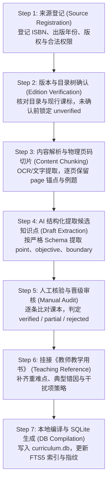

# 小学教材知识库生产流水线与合格数据标准规范
# Primary School Textbook Knowledge Pipeline & Data Standard Specification

> **核心定位**：数据质量是出题系统唯一的生命线。知识库建设坚持“来源可溯（Provenance）、版本确权、课时细化、教参双驱、人工核验、代码编译”的原则。  
> **数据形态**：JSON/YAML 为唯一事实源（Source of Truth），SQLite 为高性能离线查询引擎。

---

## 一、合格教材知识库的五层数据模型标准

一套合格的教材单元知识库，必须满足以下五层立体解耦结构，严禁扁平杂糅：

```text
L0. 教材来源注册表 (Source Registry)
     │ 记录出版单位、ISBN、审定年份、版印次、来源类型与使用权限
     ▼
L1. 单元与课时结构 (Unit & Lessons)
     │ 单元目录、课时切分、对应教材页码区间、课本原始例题切片
     ▼
L2. 正式知识点 (Knowledge Points)
     │ 知识内容、学习目标、前置知识、后置知识、允许/排除范围 (Scope)
     ▼
L3. 教师用书知识层 (Teaching Reference)
     │ 核心教学重点、突破难点、学生高频典型错因 (Typical Misconceptions)
     ▼
L4. 出题蓝图 (Question Blueprint)
     │ 题型插槽、能力梯度比例、易错干扰项设计策略、变式拓展策略
```

---

## 二、各层核心字段契约与格式规范

### 1. L0 层：教材来源注册表 (`sources.yaml` 或登记条目)

任何教材录入必须先完成来源登记，未登记的资料不得进入提取流程。

```yaml
source_id: "pep_math_g3_t1_2024"
publisher: "人民教育出版社"
subject: "math"
grade: 3
semester: "1"
edition_name: "教育部统编/审定2024年秋季义务教育教科书"
approval_year: 2024
isbn: "978-7-107-XXXXX-X"
impression: "2024年7月第1版 2024年7月第1次印刷"
source_type: "official_sample"  # official_sample | purchased_physical | user_provided
legal_permission: "research_and_local_study"
verification_status: "verified"  # verified | partial | unverified
verified_by: "auditor_name"
verified_at: "2026-10-08"
provenance_artifact: "sources/pep_math_g3_t1_copyright.png"
```

### 2. L1 层：单元与课时结构 (`lessons.yaml`)

必须细化到课时粒度，且**严格保留教材实际物理页码**，作为后续所有溯源的锚点。

```yaml
unit_id: "math_g3_t1_u04"
unit_name: "第四单元 多位数乘一位数"
source_id: "pep_math_g3_t1_2024"
total_page_range: "P56-P78"
lessons:
  - lesson_id: "lesson_01"
    lesson_name: "口算乘法"
    page_range: "P56-P58"
    official_examples:
      - example_id: "ex_1"
        title: "坐碰碰车问题"
        page: 56
        formula_or_context: "20 × 3 = 60"
        core_concept: "整十数乘一位数算理（2个十乘3得6个十）"
      - example_id: "ex_2"
        title: "坐过山车问题"
        page: 57
        formula_or_context: "12 × 3 = 36"
        core_concept: "两位数乘一位数不进位口算分步算理"
```

### 3. L2 层：正式知识点 (`knowledge_points.yaml`)

知识点是教学与命题的最小粒度原子实体。

```yaml
points:
  - point_id: "math_g3_t1_u04_p01"
    lesson_id: "lesson_01"
    point_name: "两位数乘一位数口算（不进位）"
    learning_objectives:
      - "掌握两位数乘一位数不进位的分步口算方法"
      - "理解先算几十乘几、再算几个一乘几、最后相加的算理"
    prerequisites:
      - "表内乘法（乘法口诀）"
      - "整十数乘一位数的口算"
    subsequent_points:
      - "两位数乘一位数竖式笔算（不进位）"
    teaching_boundary:
      scope_allowed:
        - "十位和个位与一位数相乘均不进位的算式（如 12×3, 23×2, 41×2）"
      scope_excluded:
        - "任何涉及数位满十进位的乘法（如 14×3, 26×2）"
        - "两位数乘两位数（下册内容）"
    provenance:
      source_id: "pep_math_g3_t1_2024"
      page_ref: [57]
      example_ref: ["ex_2"]
    audit_status: "verified"  # verified | partial | rejected
    auditor: "math_expert"
    audit_at: "2026-10-08"
```

### 4. L3 层：教师用书证据层 (`teaching_reference.yaml`)

**此层是区分“死板做题”与“专业名师辅导”的核心壁垒**。

```yaml
teaching_references:
  - point_id: "math_g3_t1_u04_p01"
    ref_book: "人教版《教师教学用书》三年级上册第四单元"
    ref_page: "P92-P95"
    pedagogical_focus:
      key_point: "口算过程中算理与算法的结合，理解拆分相乘再相加的逻辑"
      difficulty: "脱式或心算时，十位计算结果与个位计算结果合并时发生数位混淆"
      typical_misconceptions:
        - error_pattern: "12 × 3 算成 32（只乘十位 10×3=30，忘记乘个位 2）"
          misconception_type: "漏乘个位"
        - error_pattern: "12 × 3 算成 16（个位十位全加 10+2+3 或混淆运算法则）"
          misconception_type: "运算符号混淆"
        - error_pattern: "23 × 2 算成 64（把十位和个位数字反置）"
          misconception_type: "数位颠倒"
    variation_strategy:
      - "填空题：将 13×3 的拆分算理拆解为 10×( )=( )，3×( )=( )，( )+( )=( )"
      - "判断辨析题：直接呈现典型错例 12×3=32 让学生找错因"
```

### 5. L4 层：出题蓝图 (`question_blueprints.yaml`)

蓝图由知识点与教参要素生成，严格指导 LLM 命题，彻底取缔“自由发挥”。

```yaml
blueprints:
  - blueprint_id: "bp_math_g3_t1_u04_p01_daily"
    point_id: "math_g3_t1_u04_p01"
    target_practice: "课后10分钟日常练习"
    difficulty_ratio:
      basic_recall: 0.60       # 60% 基础巩固
      conceptual_variation: 0.30 # 30% 变式应用与算理解释
      thinking_challenge: 0.10   # 10% 思维挑战与逆向思考
    slots:
      - slot_id: 1
        type: "calculation"
        difficulty: "basic"
        objective: "直接口算"
        constraints: "两位数乘一位数各数位不进位，如 21×4"
      - slot_id: 2
        type: "choice"
        difficulty: "variation"
        objective: "针对典型错因设置高迷惑性干扰项"
        distractor_policy:
          option_A: "正确答案 36"
          option_B: "错因1：漏乘个位 30"
          option_C: "错因2：只乘个位 6"
          option_D: "错因3：乘法算成加法 15"
      - slot_id: 3
        type: "fill_blank"
        difficulty: "advanced"
        objective: "算理逆向推断与数字谜"
        constraints: "形如 □2 × 3 = 66，求 □ 为多少"
```

---

## 三、知识库生产流水线 SOP（7 步作业程序）



### 质量门禁与准入规则：
1. **零口头宣称原则**：无版权页证据或未核验版次者，一律禁止标记为 `verified`。
2. **页码溯源强制原则**：每个知识点必须至少有一个具体的 `page_ref`，找不到页码出处的知识点一律驳回。
3. **边界红线原则**：每个知识点必须明确 `scope_allowed` 和 `scope_excluded`，防止 AI 自作主张超纲。
4. **教参易错点闭环原则**：核心计算与概念知识点，必须至少录入 2 个以上来自真实教参或学情的 `typical_misconceptions`。
5. **Git 事实源原则**：所有增删改查必须以 YAML/JSON 文件形式提交 Git 版本控制，SQLite 只是构建产物，严禁直接手改 SQLite。

---

## 四、首个试点单元执行计划（单单元完整闭环）

- **试点单元**：人教版小学数学三年级上册新课标（2024年秋季审定版）**第四单元《多位数乘一位数》**
- **课时覆盖**：
  1. 课时 1：口算乘法（整十、整百、整千数乘一位数）
  2. 课时 2：口算乘法（两位数乘一位数不进位）
  3. 课时 3：两、三位数乘一位数笔算（不进位）
  4. 课时 4：两、三位数乘一位数笔算（一次进位与连续进位）
  5. 课时 5：因数中间或末尾有 0 的乘法
  6. 课时 6：解决问题与乘法估算
- **首期交付成果**：
  1. `sources.yaml` 来源登记表（含版权页证据与新版次确认）
  2. `lessons.yaml` 课时与例题详细切片（保留 P56-P78 页码）
  3. `knowledge_points.yaml` 12~15 个原子知识点
  4. `teaching_reference.yaml` 教学重难点与典型错因图谱
  5. `question_blueprints.yaml` 出题蓝图规范
  6. SQLite 编译刷新，且 100% 通过自动化质检脚本
